<div align="center">


# Kairo

**Gestão de pedidos para o varejo**: catálogo com estoque, clientes, pedidos com vários itens, pagamento, entrega e um painel que acompanha a loja em tempo real.


</div>

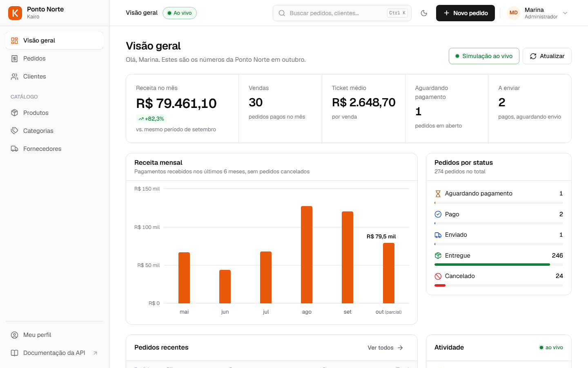

> **Kairo** e a loja **Ponto Norte** são uma marca e uma empresa fictícias, criadas para este projeto de portfólio. Os dados de demonstração são gerados automaticamente.
> O projeto começou como trabalho final da AcademiaJava UFN e foi reescrito por completo na v2 ([o que mudou](#da-v1-para-a-v2)).

## Funcionalidades

**Vendas**
- **Pedido com carrinho.** Busca de cliente, vários produtos, quantidades e total na hora; o preço de cada item fica congelado no momento da venda.
- **Ciclo completo.** Aguardando pagamento → Pago → Enviado → Entregue, com histórico de cada etapa. Cancelar antes do envio devolve os itens ao estoque.
- **Pagamento** por Pix, cartão de crédito/débito ou boleto. O estoque é baixado no pagamento, não na criação do pedido.

**Operação ao vivo**
- **Simulação de loja em funcionamento.** Com um clique, o sistema passa a receber pedidos de clientes da base e a avançar os status sozinho (pagamento, envio, entrega, cancelamentos ocasionais). Tudo passa pelas mesmas regras de negócio das ações manuais.
- **Feed de atividade** com quem fez cada ação (um funcionário ou a simulação). O painel, a lista e o detalhe dos pedidos se atualizam sem recarregar a página.
- **Notificações:** sino com contador de não lidas e avisos na tela, agrupados quando chegam vários de uma vez. Se você permitir, também chegam notificações do navegador com a aba em segundo plano. As suas próprias ações não viram notificação.

**Cadastros e integrações**
- **Endereço por CEP** via [ViaCEP](https://viacep.com.br), API pública consultada pelo back-end, com cache e mensagem clara quando o serviço externo cai.
- Produtos com SKU, categoria, fornecedor, estoque mínimo e alerta de estoque baixo; validação de CPF e CNPJ.

**Plataforma**
- Login com JWT, perfis de administrador e operador, página **Meu perfil** (dados, troca de senha, tema e sessão).
- **Busca rápida** com <kbd>Ctrl</kbd> <kbd>K</kbd> para pedidos (pelo número), clientes, produtos e páginas.
- Tema claro e escuro, layout responsivo e um rodapé com o **status real da API**: versão, ambiente e saúde do banco.

<table>
  <tr>
    <td>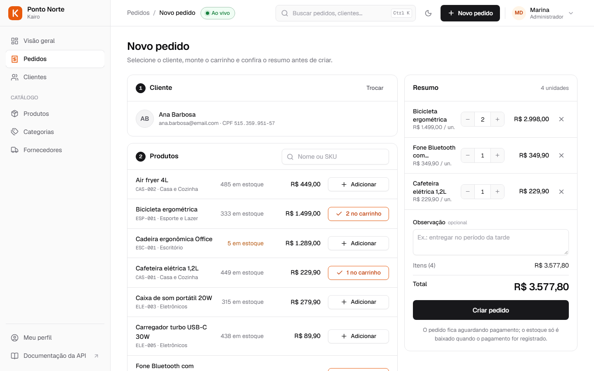</td>
    <td>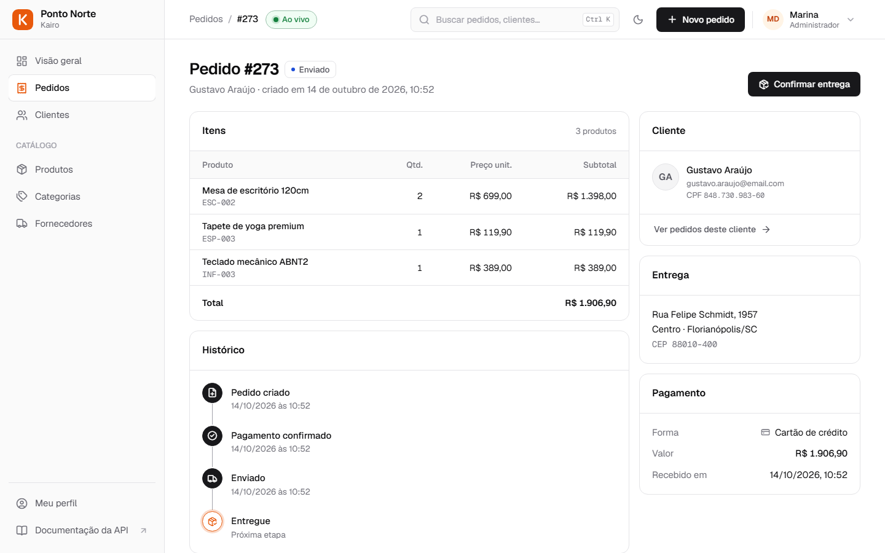</td>
  </tr>
  <tr>
    <td align="center"><sub>Novo pedido: cliente, carrinho e resumo</sub></td>
    <td align="center"><sub>Detalhe do pedido com histórico, entrega e pagamento</sub></td>
  </tr>
  <tr>
    <td>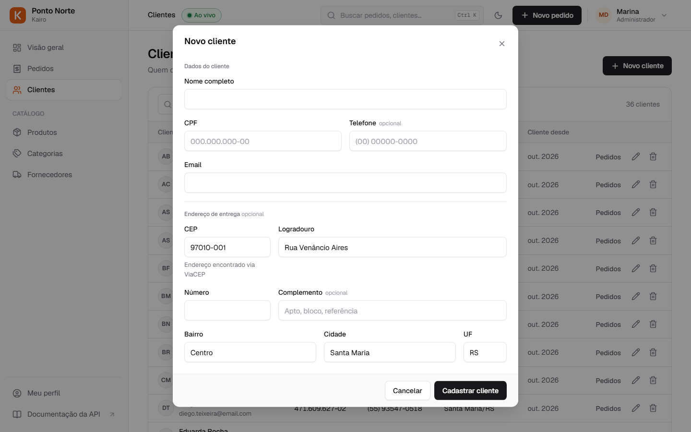</td>
    <td>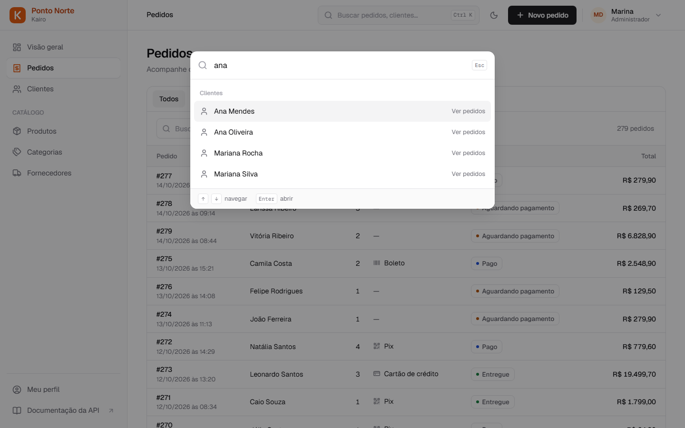</td>
  </tr>
  <tr>
    <td align="center"><sub>Endereço preenchido pelo CEP (ViaCEP)</sub></td>
    <td align="center"><sub>Busca rápida com Ctrl K</sub></td>
  </tr>
  <tr>
    <td>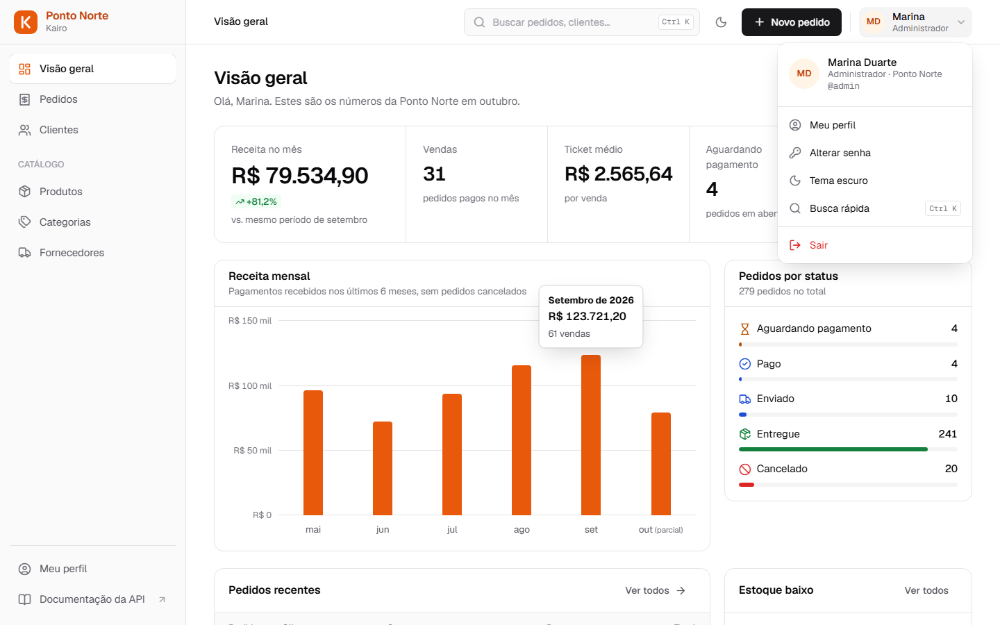</td>
    <td>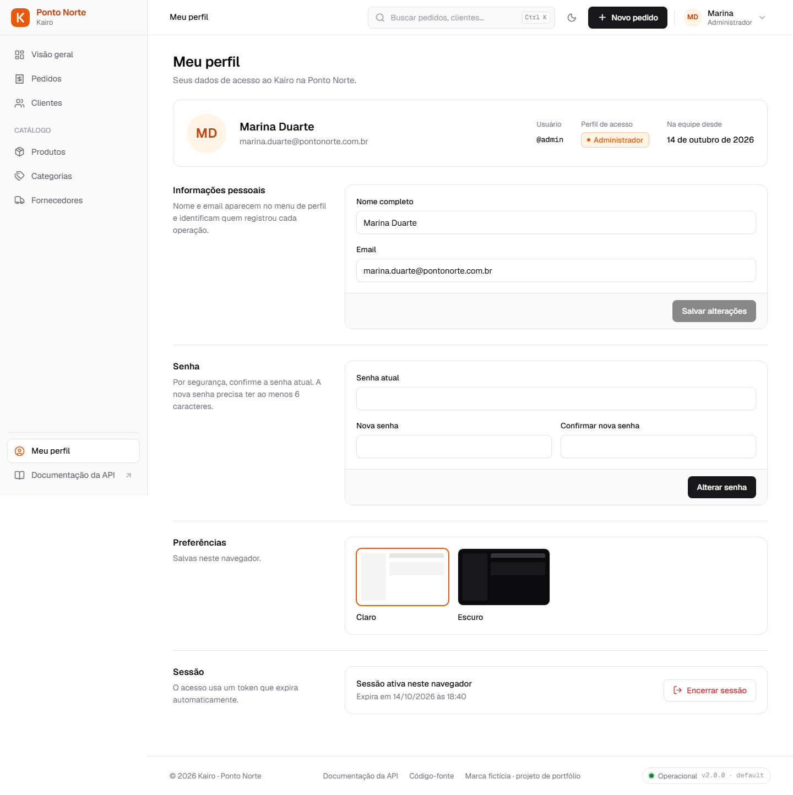</td>
  </tr>
  <tr>
    <td align="center"><sub>Menu do perfil</sub></td>
    <td align="center"><sub>Meu perfil</sub></td>
  </tr>
  <tr>
    <td>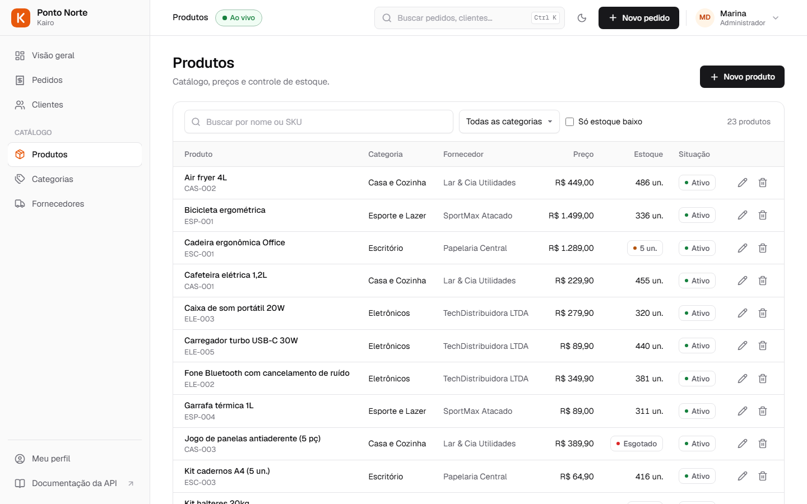</td>
    <td>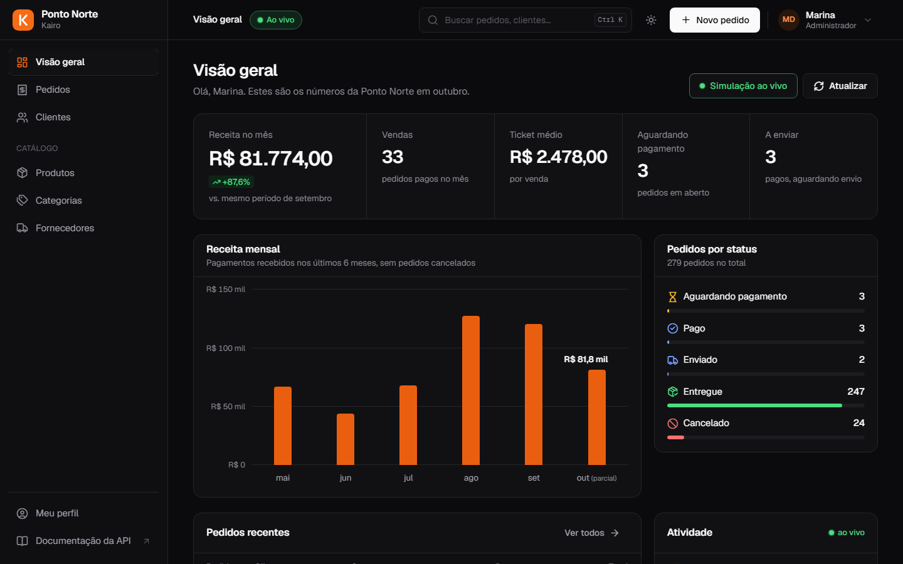</td>
  </tr>
  <tr>
    <td align="center"><sub>Catálogo com alertas de estoque</sub></td>
    <td align="center"><sub>Tema escuro</sub></td>
  </tr>
  <tr>
    <td>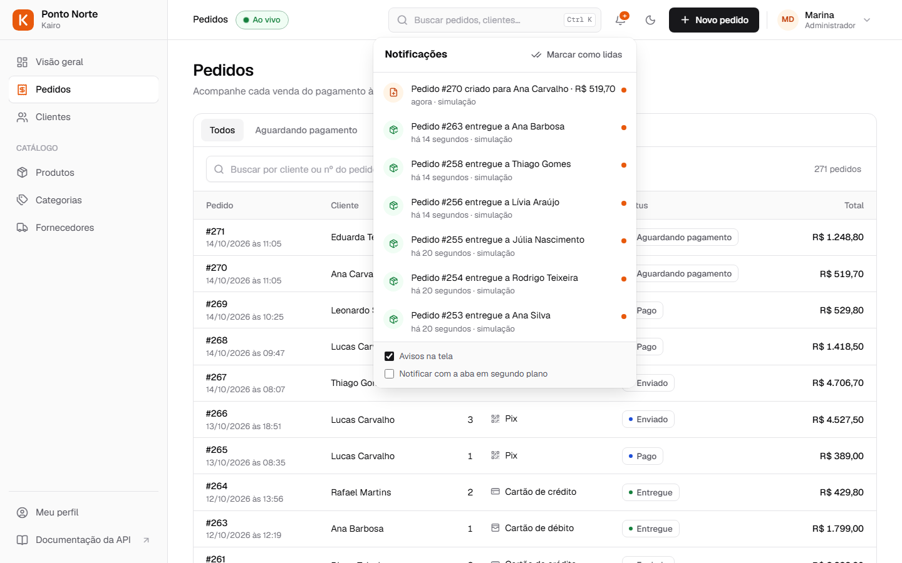</td>
    <td></td>
  </tr>
  <tr>
    <td align="center"><sub>Notificações do que acontece na loja</sub></td>
    <td align="center"><sub>Login</sub></td>
  </tr>
</table>

## Como rodar

Acesso de demonstração: **`admin` / `admin123`**.

### Opção 1 · Docker (API, interface e MySQL)

```bash
docker compose up --build
```

Abra **http://localhost:8080**. A simulação ao vivo já sobe ligada nesse modo.

### Opção 2 · Desenvolvimento (API e front separados)

Requisitos: **Java 21** e **Node.js 22**. O banco é um H2 em memória, já com dados de demonstração (36 clientes, 23 produtos e cerca de 280 pedidos nos últimos seis meses).

```bash
# terminal 1 · API em http://localhost:8080
cd backend
./mvnw spring-boot:run          # Windows: .\mvnw spring-boot:run

# terminal 2 · interface em http://localhost:4200
cd frontend
npm install
npm start
```

### Opção 3 · Um único `.jar` com a interface embutida

```bash
cd backend
./mvnw -Pembed package
java -jar target/order-management-api-2.0.0.jar     # http://localhost:8080
```

### Configuração

| Variável | Padrão | Para quê |
|---|---|---|
| `SPRING_PROFILES_ACTIVE` | `dev` (H2) | `mysql` para usar MySQL |
| `DB_HOST` · `DB_PORT` · `DB_NAME` · `DB_USER` · `DB_PASSWORD` | `localhost` · `3306` · `pedidos` · `root` · vazio | conexão MySQL (o banco é criado se não existir) |
| `JWT_SECRET` | segredo de desenvolvimento | assinatura dos tokens; **troque em produção** |
| `SIMULADOR_ATIVO` | `false` | liga a simulação ao subir (também dá para ligar pela tela) |
| `SEED_DEMO_DATA` | `true` | popula dados de demonstração quando o banco está vazio |
| `CORS_ORIGINS` | `http://localhost:4200` | origens permitidas quando o front roda em outro domínio |

A documentação interativa da API (Swagger) fica em **/swagger-ui**.

## Regras de negócio

O pedido é o agregado central: toda mudança de status passa pela entidade [`Pedido`](backend/src/main/java/com/ufn/pedidos/pedido/Pedido.java), então nenhuma parte do sistema consegue deixá-lo inconsistente.

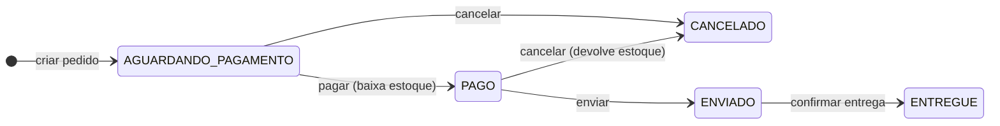

- A criação valida o estoque disponível, mas a baixa só acontece no pagamento.
- O preço unitário é copiado para o item na venda; mudanças no catálogo não alteram pedidos antigos.
- Cada pedido traz as **ações permitidas** no status atual (`acoes: ["PAGAR", "CANCELAR"]`), e a interface mostra só esses botões.
- Produtos já vendidos não podem ser excluídos (só desativados); clientes com pedidos e categorias/fornecedores com produtos também são protegidos.
- O faturamento do mês é comparado com **o mesmo período** do mês anterior, não com o mês inteiro.

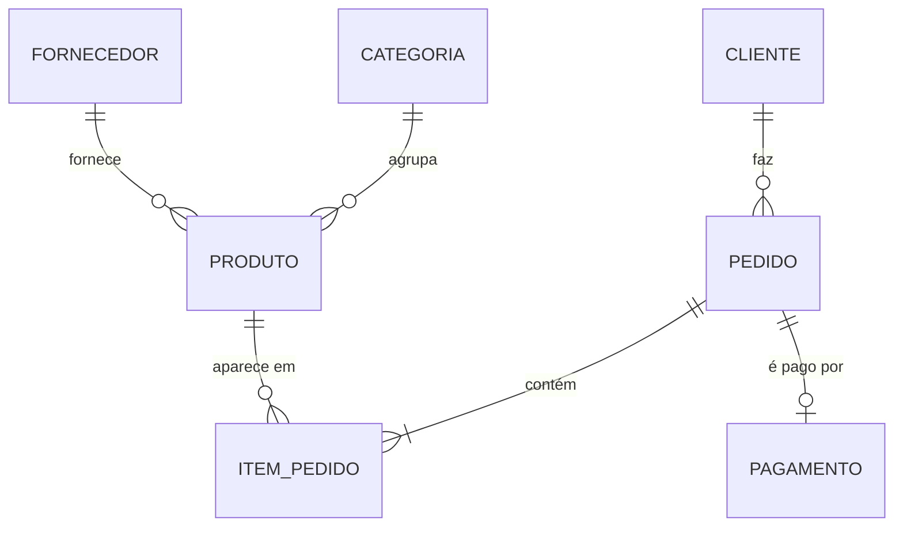

## Arquitetura

```
├── backend/    API REST · Spring Boot 3.5 · Java 21
├── frontend/   SPA · Angular 21
├── Dockerfile  build em três estágios (Angular → Maven → JRE)
└── docker-compose.yml
```

**Back-end**
- Pacotes por domínio: `auth`, `cliente`, `catalogo`, `pedido`, `dashboard`, `atividade`, `simulador`.
- Spring Security com JWT stateless e BCrypt; Bean Validation (inclusive `@CPF` e `@CNPJ`); erros no formato **Problem Details (RFC 9457)**, com os erros por campo em `erros`.
- **Flyway** versiona o schema (V1 a V3), e o mesmo script roda no H2 e no MySQL.
- Integração externa com `RestClient` (ViaCEP): timeouts, cache e status 503 quando o serviço falha.
- Simulação com `@Scheduled`, sempre pelos mesmos serviços das ações da tela.
- Paginação e filtros, `@EntityGraph` e *batch fetching* contra N+1, `Clock` injetável nos testes.
- No perfil `embed`, o jar serve também a SPA, com as rotas do Angular redirecionadas para o `index.html`.

**Front-end**
- Angular 21 **standalone e sem zone.js**: estado com *signals*, dados com `rxResource`, rotas com *lazy loading*.
- Interceptor de JWT (encerra a sessão ao receber 401) e guards de rota.
- Design system próprio em CSS (tokens claro e escuro, fonte Geist, ícones Lucide), sem biblioteca de componentes.
- Gráfico de receita em HTML/CSS acessível, com tooltip e tabela para leitores de tela; cores validadas para contraste e daltonismo.

### Principais endpoints

| Método | Rota | Descrição |
|---|---|---|
| `POST` | `/api/auth/login` · `/api/auth/registro` | Autenticação |
| `GET` `PUT` | `/api/me` · `/api/me/senha` | Perfil do usuário logado |
| `GET` | `/api/dashboard` | Indicadores de vendas e estoque |
| `GET` `POST` | `/api/pedidos` | Lista (filtros `status`, `clienteId`, `busca`) e criação |
| `POST` | `/api/pedidos/{id}/pagamento` · `/envio` · `/entrega` · `/cancelamento` | Transições de status |
| `GET` | `/api/cep/{cep}` | Endereço via ViaCEP |
| `GET` `PUT` | `/api/simulador` · `GET /api/atividades` | Simulação ao vivo e feed de eventos |
| `GET` | `/api/info` | Versão, ambiente e saúde do banco (público) |
| CRUD | `/api/produtos` · `/api/clientes` · `/api/categorias` · `/api/fornecedores` | Cadastros |

## Testes

```bash
cd backend && ./mvnw test
```

São 25 testes:
- **Domínio:** total, estoque no pagamento e no cancelamento, transições inválidas, preço congelado.
- **API (MockMvc + H2):** fluxo de pagamento, autenticação, perfil e troca de senha, validação por campo.
- **Simulador:** gera pedidos e atividade só quando está ligado.

## Da v1 para a v2

| v1 | v2 |
|---|---|
| Um pedido tinha um único produto | Pedido com vários itens e total calculado |
| Pagamento separado, valor digitado à mão e sempre "Aprovado" | Pagamento do valor do pedido, com método e data |
| "Checkout" como entidade extra | Removido: o checkout é o próprio fluxo do pedido |
| Sem estoque e sem status | Estoque baixado e devolvido; status com regras de transição |
| IDs digitados nos formulários | Busca e seleção de clientes e produtos; endereço por CEP |
| Sem validação nem tratamento de erros | Bean Validation + Problem Details, com erro por campo na tela |
| Angular 17 com NgModules e Bootstrap/Material | Angular 21 standalone, signals e design system próprio |
| Precisava de MySQL instalado | H2 com dados de demonstração, MySQL opcional, Docker |
| Sem testes | 25 testes de domínio, API e simulação |
